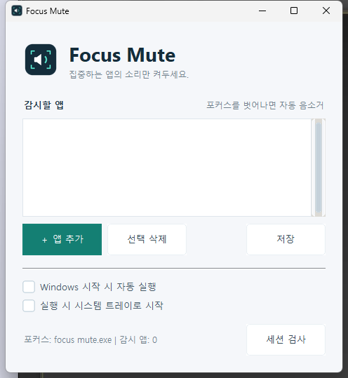

# Focus Mute

A minimal Windows utility that keeps sound on for the app you are using and automatically mutes watched apps when they lose focus.

[Download the latest release](https://github.com/BE0X01/focus-mute/releases/latest)

## Preview

## Features

- Automatically mute watched apps in the background and unmute them when focused.
- Keep minimized watched apps muted.
- Add running processes using a searchable picker.
- Remove apps, save your watch list, and inspect audio sessions.
- Optional Windows startup and start in the system tray.
- Minimize to the tray; double-click the tray icon to reopen.
- Unmute watched apps and save settings on exit.
- Minimal interface with subtle rounded buttons, custom checkboxes, a slim scrollbar, and a matching app icon.

The interface is in Korean. Audio control applies to Windows audio sessions matched by executable name.

## Getting started

1. Download `Focus-Mute-1.0-Windows-x64.zip` from the [latest release](https://github.com/BE0X01/focus-mute/releases/latest).
2. Extract it to a writable folder and run `Focus Mute.exe`.
3. Click **＋ 앱 추가** (Add app), search for a running process, and select it.
4. Click **저장** (Save). Focus Mute starts monitoring automatically.

The **선택 삭제** button removes the selected app and unmutes it. **세션 검사** shows detected audio sessions. Minimizing the window sends it to the system tray; closing it exits the app.

Windows x64 is required. Python is not required for the packaged executable. Applications must have an active audio session for their sound to be controlled.

## Settings

`focusmute.ini` is created next to the executable. It stores watched executable names and startup options. Keep the app in a writable folder. Enable Windows startup after placing the executable in its permanent location.

Personal settings are not included in the release.

## License

Project source is licensed under the [MIT License](LICENSE). Bundled third-party components retain their own licenses; their notices are included in the portable ZIP.
